<b>12 free browser games, each one made by a single Claude model: Opus 5.5, Sonnet 5.5, Fable 5.1 or Haiku 5.5.</b> 
Each game's code is one <code>index.html</code> on Three.js r170: no install, no account, it opens in a browser tab. 
Her oyunu tek bir Claude modeli yaptı. Her oyunun kodu Three.js r170 ile tek bir <code>index.html</code>: kurulum yok, hesap yok, tarayıcı sekmesinde açılır.

<picture>
  <source media="(prefers-color-scheme: dark)" srcset="assets/profile/divider-games-dark.svg">
  
</picture>

## 01 · Play · Oyna

Claude Game Arena: one Claude model per game, and the model is named in each repository's <code>project-meta.json</code>. Click a banner to play. · Her oyunu tek bir model yaptı; model her deponun <code>project-meta.json</code> dosyasında yazıyor. Oynamak için afişe tıkla.

### Round 4 · Tur 4

<table>
<tr>
<td width="50%" valign="top">

 
<b>Captain an Istanbul ferry on the Bosphorus: keep the timetable and dock against the current.</b> 
Boğaz'da vapur kaptanı ol: tarifeye uy, akıntıya karşı iskeleye yanaş.

<a href="https://raw.githubusercontent.com/Furkiozknn/bogaz-vapuru/main/docs/gameplay.gif">gameplay GIF</a> (5.4 MB)
</td>
<td width="50%" valign="top">

 
<b>Run a simit bakery in Istanbul: bake, staff the oven and send simit sellers across town.</b> 
İstanbul'da simit fırını işlet: fırınla, ustaları yerleştir, simitçileri sokağa gönder.

<a href="https://raw.githubusercontent.com/Furkiozknn/simit-firini/main/docs/gameplay.gif">gameplay GIF</a> (3.7 MB)
</td>
</tr>
<tr>
<td width="50%" valign="top">

 
<b>Light the shadow theatre: move puppets and lamps until Karagöz and Hacivat match the picture.</b> 
Gölge oyununu aydınlat: tasvirleri ve kandilleri oynat, Karagöz ile Hacivat sahneye çıksın.

<a href="https://raw.githubusercontent.com/Furkiozknn/karagoz/main/docs/gameplay.gif">gameplay GIF</a> (5.1 MB)
</td>
<td width="50%" valign="top">

 
<b>Grow a tulip garden in the Ottoman Tulip Era: breed new varieties and win the Sultan's festival.</b> 
Lale Devri'nde bahçe kur: yeni çeşitler melezle, Sultan'ın şenliğini kazan.

<a href="https://raw.githubusercontent.com/Furkiozknn/lale-bahcesi/main/docs/gameplay.gif">gameplay GIF</a> (3.0 MB)
</td>
</tr>
</table>

### Round 3 · Tur 3

<table>
<tr>
<td width="50%" valign="top">

 
<b>Lead camel caravans across Anatolia: buy low, sell high, build caravanserais.</b> 
Deve kervanlarıyla Anadolu'da ucuza al, pahalıya sat, kervansaray kur.

<a href="https://raw.githubusercontent.com/Furkiozknn/kervan/main/docs/gameplay.gif">gameplay GIF</a> (6.6 MB) · promo video <a href="https://github.com/Furkiozknn/social-videos/releases/download/promo-2026-10/2026-10-27-kervan-en.mp4">EN</a> · <a href="https://github.com/Furkiozknn/social-videos/releases/download/promo-2026-10/2026-10-27-kervan-tr.mp4">TR</a>
</td>
<td width="50%" valign="top">

 
<b>Drive a yellow dolmuş through Istanbul: pick up passengers, learn their stops, earn fares and tips.</b> 
Sarı dolmuşla İstanbul'da yolcu al, durağını öğren, ücret ve bahşiş topla.

<a href="https://raw.githubusercontent.com/Furkiozknn/dolmus/main/docs/gameplay.gif">gameplay GIF</a> (5.2 MB) · promo video <a href="https://github.com/Furkiozknn/social-videos/releases/download/promo-2026-10/2026-10-28-dolmus-en.mp4">EN</a> · <a href="https://github.com/Furkiozknn/social-videos/releases/download/promo-2026-10/2026-10-28-dolmus-tr.mp4">TR</a>
</td>
</tr>
<tr>
<td width="50%" valign="top">

 
<b>Mini-golf among the fairy chimneys of Cappadocia: 12 holes, real physics, a pottery wheel and a donkey.</b> 
Kapadokya peribacaları arasında mini golf: 12 delik, gerçek fizik, çömlek tezgâhı ve eşek.

<a href="https://raw.githubusercontent.com/Furkiozknn/peri-golf/main/docs/gameplay.gif">gameplay GIF</a> (8.0 MB) · promo video <a href="https://github.com/Furkiozknn/social-videos/releases/download/promo-2026-10/2026-10-27-peri-golf-en.mp4">EN</a> · <a href="https://github.com/Furkiozknn/social-videos/releases/download/promo-2026-10/2026-10-27-peri-golf-tr.mp4">TR</a>
</td>
<td width="50%" valign="top">

 
<b>March with the Ottoman mehter band: hit the davul, kös, zurna and zil on the beat.</b> 
Mehter takımıyla yürü: davul, kös, zurna ve zili tam vuruşta çal.

<a href="https://raw.githubusercontent.com/Furkiozknn/mehter/main/docs/gameplay.gif">gameplay GIF</a> (4.3 MB) · promo video <a href="https://github.com/Furkiozknn/social-videos/releases/download/promo-2026-10/2026-10-28-mehter-en.mp4">EN</a> · <a href="https://github.com/Furkiozknn/social-videos/releases/download/promo-2026-10/2026-10-28-mehter-tr.mp4">TR</a>
</td>
</tr>
</table>

### Round 1 · Tur 1

<table>
<tr>
<td width="50%" valign="top">

 
<b>Hold a seaside fortress for 15 waves with archers, cannons and boiling tar.</b> 
Okçu, top ve katranla sahil kalesini 15 dalga boyunca savun.

15 waves · 60 fps on Intel UHD with 37-42 draw calls · <a href="https://raw.githubusercontent.com/Furkiozknn/kale-savunmasi/main/docs/gameplay.gif">gameplay GIF</a> (2.1 MB)
</td>
<td width="50%" valign="top">

 
<b>Run a tiny Istanbul tea house: brew tea, warm simit, serve every table in time.</b> 
Küçük bir çay ocağı işlet: çay demle, simit ısıt, her masaya yetiş.

The ?auto bot won 84 of 90 seeded games · <a href="https://raw.githubusercontent.com/Furkiozknn/cay-ocagi/main/docs/gameplay.gif">gameplay GIF</a> (1.2 MB)
</td>
</tr>
<tr>
<td width="50%" valign="top">

 
<b>Rotate, swap and flip Iznik tiles until every motif connects, then fire the panel.</b> 
İznik çinilerini çevir, desenleri birleştir, panoyu fırında pişir.

30 levels · 345/345 core tests pass · bot run 90 of 90 stars · <a href="https://raw.githubusercontent.com/Furkiozknn/cini-ustasi/main/docs/gameplay.gif">gameplay GIF</a> (6.9 MB)
</td>
<td width="50%" valign="top">

 
<b>Fly a seagull over the Bosphorus: snatch simit from ferries, dodge the bridge.</b> 
Boğaz üstünde uç, vapurdan simit kap, köprüden kaç.

A bot run in a real browser flew 796 s · <a href="https://raw.githubusercontent.com/Furkiozknn/marti/main/docs/gameplay.gif">gameplay GIF</a> (5.0 MB)
</td>
</tr>
</table>
The gameplay GIFs are linked, not embedded: together they weigh 57 MB, so this page loads only the banners. · GIF'ler sayfaya gömülü değil, bağlantı olarak duruyor: toplam 57 MB.

<picture>
  <source media="(prefers-color-scheme: dark)" srcset="assets/profile/divider-watch-dark.svg">
  
</picture>

## 02 · Watch · İzle

Short videos about how the games are made: English on YouTube and X, Turkish on Instagram. Each post says when the voice is AI-generated. 
Oyunların nasıl yapıldığını anlatan kısa videolar: YouTube ve X'te İngilizce, Instagram'da Türkçe. Yapay zekâ sesi her gönderide belirtilir.

**Promo videos · Tanıtım videoları** (MP4 on GitHub Releases; the link opens the file · bağlantı dosyayı açar)

| Game | English | Türkçe | Date |
|---|---|---|---|
| Kervan | [▶ EN](https://github.com/Furkiozknn/social-videos/releases/download/promo-2026-10/2026-10-27-kervan-en.mp4) | [▶ TR](https://github.com/Furkiozknn/social-videos/releases/download/promo-2026-10/2026-10-27-kervan-tr.mp4) | 2026-10-27 |
| Peri Golf | [▶ EN](https://github.com/Furkiozknn/social-videos/releases/download/promo-2026-10/2026-10-27-peri-golf-en.mp4) | [▶ TR](https://github.com/Furkiozknn/social-videos/releases/download/promo-2026-10/2026-10-27-peri-golf-tr.mp4) | 2026-10-27 |
| Mehter | [▶ EN](https://github.com/Furkiozknn/social-videos/releases/download/promo-2026-10/2026-10-28-mehter-en.mp4) | [▶ TR](https://github.com/Furkiozknn/social-videos/releases/download/promo-2026-10/2026-10-28-mehter-tr.mp4) | 2026-10-28 |
| Dolmuş | [▶ EN](https://github.com/Furkiozknn/social-videos/releases/download/promo-2026-10/2026-10-28-dolmus-en.mp4) | [▶ TR](https://github.com/Furkiozknn/social-videos/releases/download/promo-2026-10/2026-10-28-dolmus-tr.mp4) | 2026-10-28 |

Rounds 4 and 1 have no promo video yet; their gameplay GIFs: [Boğaz Vapuru](https://raw.githubusercontent.com/Furkiozknn/bogaz-vapuru/main/docs/gameplay.gif) · [Simit Fırını](https://raw.githubusercontent.com/Furkiozknn/simit-firini/main/docs/gameplay.gif) · [Karagöz](https://raw.githubusercontent.com/Furkiozknn/karagoz/main/docs/gameplay.gif) · [Lale Bahçesi](https://raw.githubusercontent.com/Furkiozknn/lale-bahcesi/main/docs/gameplay.gif) · [Hisar](https://raw.githubusercontent.com/Furkiozknn/kale-savunmasi/main/docs/gameplay.gif) · [Çay Ocağı](https://raw.githubusercontent.com/Furkiozknn/cay-ocagi/main/docs/gameplay.gif) · [Çini Ustası](https://raw.githubusercontent.com/Furkiozknn/cini-ustasi/main/docs/gameplay.gif) · [Martı](https://raw.githubusercontent.com/Furkiozknn/marti/main/docs/gameplay.gif). · 4. ve 1. turun tanıtım videosu henüz yok; oynanış GIF'leri yukarıda.

<picture>
  <source media="(prefers-color-scheme: dark)" srcset="assets/profile/divider-now-dark.svg">
  
</picture>

## 03 · Now · Şu an

Updated 2026-10-27 · Güncelleme 2026-10-27

- 🎮 **12 games are live on GitHub Pages**, four per round, and every model made three of them. · 12 oyun GitHub Pages'te yayında; her model üçer oyun yaptı.
- 🎬 **Next: promo videos for the Round 4 and Round 1 games.** Until they exist, the GIFs above stand in. · Sıradaki iş: 4. ve 1. tur oyunlarının tanıtım videoları.
- 🗂️ **Every repository on one page:** the [project directory](https://furkiozknn.github.io/) is built from each repository's own `project-meta.json`. · Bütün depolar tek sayfada.

<picture>
  <source media="(prefers-color-scheme: dark)" srcset="assets/profile/divider-end-dark.svg">
  
</picture>

  <a href="https://furkiozknn.github.io/">Project directory</a> ·
  <a href="https://github.com/Furkiozknn/social-videos">social-videos</a> ·
  <a href="https://github.com/Furkiozknn?tab=repositories">All repositories</a> ·
  <a href="https://x.com/Furkiozkann">@Furkiozkann</a>

