<b>21 free browser games, each one made by a single Claude model: Opus 5.5, Sonnet 5.5, Fable 5.1 or Haiku 5.5.</b> 
Each game's code is one <code>index.html</code> on Three.js r170: no install, no account, it opens in a browser tab. 
Her oyunu tek bir Claude modeli yaptı. Her oyunun kodu Three.js r170 ile tek bir <code>index.html</code>: kurulum yok, hesap yok, tarayıcı sekmesinde açılır.

<picture>
  <source media="(prefers-color-scheme: dark)" srcset="assets/profile/divider-games-dark.svg">
  
</picture>

## 01 · Play · Oyna

Claude Game Arena: one Claude model per game, and the model is named in each repository's <code>project-meta.json</code>. Click a banner to play. · Her oyunu tek bir model yaptı; model her deponun <code>project-meta.json</code> dosyasında yazıyor. Oynamak için afişe tıkla.

Order: most visited first, by GitHub traffic for each game's repository over the 14 days to 2026-11-20. · Sıra: en çok ziyaret edilenden aza doğru; her oyunun deposunun 2026-11-20'ye kadarki 14 günlük GitHub trafiğine göre.

<table>
<tr>
<td width="50%" valign="top">

 
<b>Sail a white ferry between six Bosphorus piers, keep the timetable and dock gently before passengers give up.</b> 
Altı Boğaz iskelesi arasında vapur sür, tarifeye uy ve yolcular vazgeçmeden iskeleye yumuşakça yanaş.

<a href="https://raw.githubusercontent.com/Furkiozknn/bogaz-vapuru/main/docs/gameplay.gif">gameplay GIF</a> (5.4 MB)
</td>
<td width="50%" valign="top">

 
<b>Track anchovy schools on the sonar, set the net around them and sell fresh at the market over a 30-day season.</b> 
Sonarda hamsi sürülerini bul, ağı etraflarına çevir ve 30 günlük sezon boyunca taze balığı pazarda sat.

<a href="https://raw.githubusercontent.com/Furkiozknn/hamsi/main/docs/gameplay.gif">gameplay GIF</a> (5.4 MB)
</td>
</tr>
<tr>
<td width="50%" valign="top">

 
<b>Putt through twelve hand-designed holes among Cappadocia's fairy chimneys, with rolling physics and hidden shortcuts.</b> 
Kapadokya peribacaları arasında on iki özel tasarım delikte gerçek fizikle golf oyna, gizli kestirmeleri bul.

<a href="https://raw.githubusercontent.com/Furkiozknn/peri-golf/main/docs/gameplay.gif">gameplay GIF</a> (8.0 MB) · promo video <a href="https://github.com/Furkiozknn/social-videos/releases/download/promo-2026-10/2026-10-27-peri-golf-en.mp4">EN</a> · <a href="https://github.com/Furkiozknn/social-videos/releases/download/promo-2026-10/2026-10-27-peri-golf-tr.mp4">TR</a>
</td>
<td width="50%" valign="top">

 
<b>Defend a seaside fortress with archers, cannons and tar cauldrons before a battering ram breaks through the gate.</b> 
Okçu, top ve katran kazanıyla sahil kalesini savun, koçbaşı kapıyı kırıp içeri girmeden onu durdur.

15 waves · 60 fps on Intel UHD with 37-42 draw calls · <a href="https://raw.githubusercontent.com/Furkiozknn/kale-savunmasi/main/docs/gameplay.gif">gameplay GIF</a> (2.1 MB)
</td>
</tr>
<tr>
<td width="50%" valign="top">

 
<b>Knead, shape and bake simit, staff the oven so the bread never burns and send sellers across the neighbourhood.</b> 
Simidi yoğur, şekil ver ve pişir, ekmek yanmasın diye fırına işçi koy, simitçileri mahalleye dağıt.

<a href="https://raw.githubusercontent.com/Furkiozknn/simit-firini/main/docs/gameplay.gif">gameplay GIF</a> (3.7 MB)
</td>
<td width="50%" valign="top">

 
<b>Lead camel caravans between seven Anatolian cities, buy low, sell high and build three caravanserais in five years.</b> 
Yedi Anadolu şehri arasında deve kervanı yönet, ucuza alıp pahalıya sat, beş yıl içinde üç kervansaray kur.

<a href="https://raw.githubusercontent.com/Furkiozknn/kervan/main/docs/gameplay.gif">gameplay GIF</a> (6.6 MB) · promo video <a href="https://github.com/Furkiozknn/social-videos/releases/download/promo-2026-10/2026-10-27-kervan-en.mp4">EN</a> · <a href="https://github.com/Furkiozknn/social-videos/releases/download/promo-2026-10/2026-10-27-kervan-tr.mp4">TR</a>
</td>
</tr>
<tr>
<td width="50%" valign="top">

 
<b>Rotate, swap and flip hand-painted Iznik tiles until every motif connects, then fire the panel in a glowing kiln.</b> 
İznik çinilerini çevir, yer değiştir, ters çevir; desenler birleşince panoyu kor gibi parlayan fırında pişir.

30 levels · 345/345 core tests pass · bot run 90 of 90 stars · <a href="https://raw.githubusercontent.com/Furkiozknn/cini-ustasi/main/docs/gameplay.gif">gameplay GIF</a> (6.9 MB)
</td>
<td width="50%" valign="top">

 
<b>Drive a yellow dolmuş around an Istanbul neighbourhood, pick up waving riders, drop them off and earn fares and tips.</b> 
Sarı dolmuşla bir İstanbul mahallesinde el sallayan yolcuları al, durağında indir, ücret ve bahşiş kazan.

<a href="https://raw.githubusercontent.com/Furkiozknn/dolmus/main/docs/gameplay.gif">gameplay GIF</a> (5.2 MB) · promo video <a href="https://github.com/Furkiozknn/social-videos/releases/download/promo-2026-10/2026-10-28-dolmus-en.mp4">EN</a> · <a href="https://github.com/Furkiozknn/social-videos/releases/download/promo-2026-10/2026-10-28-dolmus-tr.mp4">TR</a>
</td>
</tr>
<tr>
<td width="50%" valign="top">

 
<b>Build an Ottoman mosque from piers, arches and half-domes, then pull the scaffolding and see if the dome stands.</b> 
Ayak, kemer ve yarım kubbelerle bir Osmanlı camisi kur, iskeleyi sök ve kubbenin ayakta kalıp kalmadığını gör.

<a href="https://raw.githubusercontent.com/Furkiozknn/mimar-sinan/main/docs/gameplay.gif">gameplay GIF</a> (3.4 MB)
</td>
<td width="50%" valign="top">

 
<b>Sneak through the palace at night and put the real Spoon-maker's Diamond back before dawn without being caught.</b> 
Geceleyin sarayda gizlice ilerle, gerçek Kaşıkçı Elması'nı şafaktan önce yakalanmadan yerine koy.

<a href="https://raw.githubusercontent.com/Furkiozknn/topkapi-gecesi/main/docs/gameplay.gif">gameplay GIF</a> (5.6 MB)
</td>
</tr>
<tr>
<td width="50%" valign="top">

 
<b>Wrestle in oil, grip and throw your rival until his back touches the grass, then work toward the golden belt.</b> 
Yağlı güreşte rakibi tut, çek ve at; sırtı çimene değene kadar sürdür, altın kemere doğru yüksel.

<a href="https://raw.githubusercontent.com/Furkiozknn/kirkpinar/main/docs/gameplay.gif">gameplay GIF</a> (6.1 MB)
</td>
<td width="50%" valign="top">

 
<b>Fly a seagull over the Bosphorus, snatch simit from ferries, dodge the bridges and raise a chick that grows.</b> 
Boğaz üstünde martıyla uç, vapurlardan simit kap, köprülerden kaç ve uçuştan uçuşa büyüyen yavruyu besle.

A bot run in a real browser flew 796 s · <a href="https://raw.githubusercontent.com/Furkiozknn/marti/main/docs/gameplay.gif">gameplay GIF</a> (5.0 MB)
</td>
</tr>
<tr>
<td width="50%" valign="top">

 
<b>Pilot a hot-air balloon with no rudder over Cappadocia and ride the wind layer that blows toward your goal.</b> 
Kapadokya'da dümensiz sıcak hava balonunu uçur, hedefe doğru esen rüzgâr katmanını bulup ona bin.

<a href="https://raw.githubusercontent.com/Furkiozknn/kapadokya-balonu/main/docs/gameplay.gif">gameplay GIF</a> (6.2 MB)
</td>
<td width="50%" valign="top">

 
<b>Chase the cat that stole a jeweller's ring over bazaar domes, rooftops and laundry lines across ten levels.</b> 
Kuyumcunun yüzüğünü çalan kediyi çarşının kubbeleri, çatıları ve çamaşır ipleri üzerinde on bölümde kovala.

<a href="https://raw.githubusercontent.com/Furkiozknn/carsi-kacisi/main/docs/gameplay.gif">gameplay GIF</a> (6.2 MB)
</td>
</tr>
<tr>
<td width="50%" valign="top">

 
<b>Marble thickened water with awl and comb until the pattern matches the master's, then lay the paper on the tray.</b> 
Kıvamlı suya boya damlat, bizle ve tarakla şekil ver; desen ustanınkine uyunca kâğıdı tekneye yatır.

<a href="https://raw.githubusercontent.com/Furkiozknn/ebru/main/docs/gameplay.gif">gameplay GIF</a> (2.9 MB)
</td>
<td width="50%" valign="top">

 
<b>Slide leather puppets of Karagöz and Hacivat and move oil lamps until their shadows match the story picture.</b> 
Karagöz ile Hacivat tasvirlerini kaydır, yağ kandillerini oynat; perdedeki gölgeler hikâye resmine uysun.

<a href="https://raw.githubusercontent.com/Furkiozknn/karagoz/main/docs/gameplay.gif">gameplay GIF</a> (5.1 MB)
</td>
</tr>
<tr>
<td width="50%" valign="top">

 
<b>Brew tea, warm simit and keep Turkish coffee from boiling over while ferry rushes bring two or three parties at once.</b> 
Çay demle, simit ısıt, Türk kahvesini taşırma ve vapurla bir anda gelen iki üç müşteri grubuna yetiş.

The ?auto bot won 84 of 90 seeded games · <a href="https://raw.githubusercontent.com/Furkiozknn/cay-ocagi/main/docs/gameplay.gif">gameplay GIF</a> (1.2 MB)
</td>
<td width="50%" valign="top">

 
<b>Plant tulip bulbs on a palace terrace, cross neighbouring blooms for new varieties and win the Sultan's festival.</b> 
Saray terasına lale soğanı dik, komşu çiçekleri melezleyip yeni çeşitler üret, Sultan'ın şenliğini kazan.

<a href="https://raw.githubusercontent.com/Furkiozknn/lale-bahcesi/main/docs/gameplay.gif">gameplay GIF</a> (3.0 MB)
</td>
</tr>
<tr>
<td width="50%" valign="top">

 
<b>Shift rows and columns to bring water and roads to the villages while a quake moves one row after every move.</b> 
Satır ve sütunları kaydırıp köylere su ve yol ulaştır; her hamleden sonra bir deprem bir satırı oynatır.

<a href="https://raw.githubusercontent.com/Furkiozknn/fay-hatti/main/docs/gameplay.gif">gameplay GIF</a> (1.5 MB)
</td>
<td width="50%" valign="top">

 
<b>Guide warm spring water down the white terraces with stones, dams and splitters while still water builds new rims.</b> 
Ilık kaynak suyunu taş, set ve ayırıcıyla beyaz teraslardan havuzlara indir; duran su yeni kenarlar örer.

<a href="https://raw.githubusercontent.com/Furkiozknn/pamukkale/main/docs/gameplay.gif">gameplay GIF</a> (2.2 MB)
</td>
</tr>
<tr>
<td width="50%" valign="top">

 
<b>Play six Ottoman mehter marches, hit davul, kös, zurna and zil notes on the beat and keep the band's spirit up.</b> 
Altı Osmanlı mehter marşında davul, kös, zurna ve zil notalarını tam vuruşta çal, takımın moralini yüksek tut.

<a href="https://raw.githubusercontent.com/Furkiozknn/mehter/main/docs/gameplay.gif">gameplay GIF</a> (4.3 MB) · promo video <a href="https://github.com/Furkiozknn/social-videos/releases/download/promo-2026-10/2026-10-28-mehter-en.mp4">EN</a> · <a href="https://github.com/Furkiozknn/social-videos/releases/download/promo-2026-10/2026-10-28-mehter-tr.mp4">TR</a>
</td>
<td width="50%" valign="top"></td>
</tr>
</table>

<picture>
  <source media="(prefers-color-scheme: dark)" srcset="assets/profile/divider-end-dark.svg">
  
</picture>

  <a href="https://furkiozknn.github.io/">Project directory</a> ·
  <a href="https://github.com/Furkiozknn/social-videos">social-videos</a> ·
  <a href="https://github.com/Furkiozknn?tab=repositories">All repositories</a> ·
  <a href="https://x.com/Furkiozkann">@Furkiozkann</a> ·
  <a href="https://buymeacoffee.com/furkiozkann">Buy me a coffee</a>

